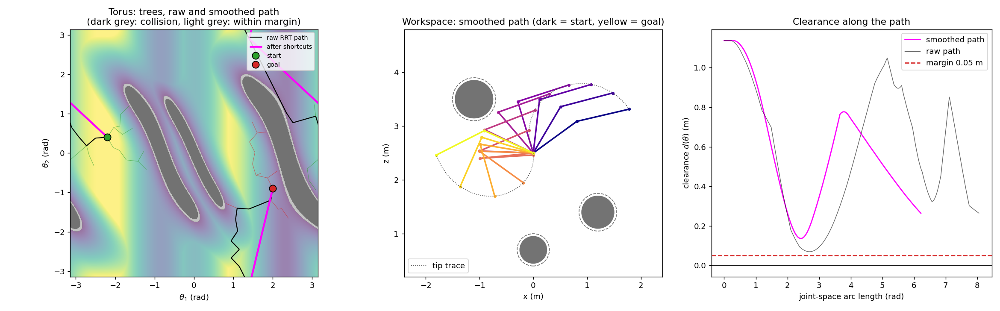
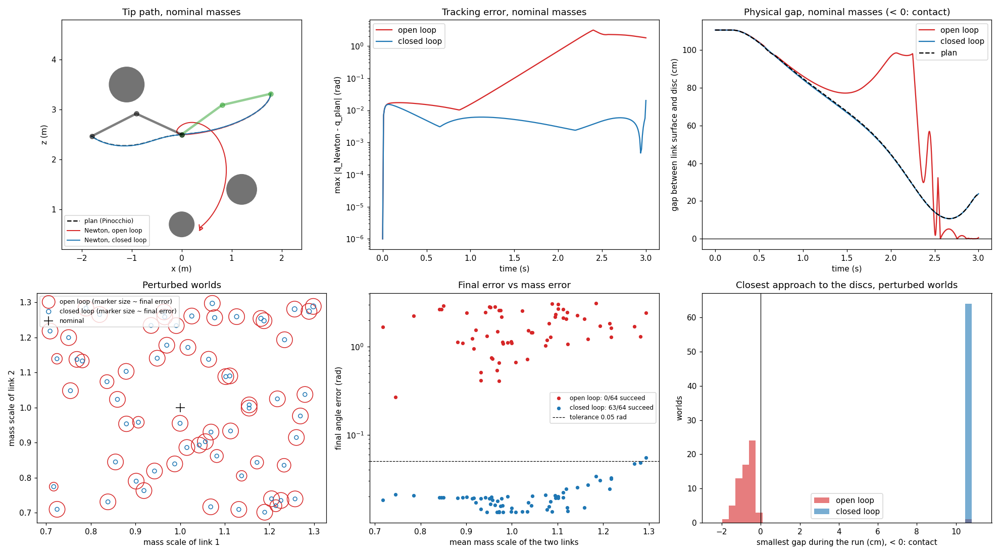

# Plan in Pinocchio, execute in Newton: a 2-link arm around obstacles

A planar 2-link arm must move between two configurations without touching three disc-shaped obstacles.
Pinocchio plans and optimises the motion; NVIDIA Newton executes it with real collision shapes, and the
project measures whether the plan survives the change of simulator, time step and masses.
Newton is first validated against Pinocchio, so that every later difference has a known cause.

**In short**

- **Validation:** Newton's Featherstone solver matches Pinocchio's `aba` to float32 precision (median relative error 3e-6) and converges at first order to a Runge-Kutta 4 reference.
- **Planning on the torus:** the configuration space is 𝕋² = S¹ × S¹. RRT-Connect plans on it, and every edge is *proved* collision-free with a Lipschitz bound instead of being sampled. The clearance grid also runs as a Warp kernel, 11–15× faster than NumPy on CPU.
- **Optimisation:** iLQR, with Pinocchio's analytic derivatives, turns the path into torques that respect the motor limits.
- **Execution in Newton:**
  - Replaying the planned torques open loop hits an obstacle even with exact masses. The arm is unstable around the plan, and switching from 10 ms to 1 ms steps is enough to make it diverge.
  - With iLQR's own feedback gains, 63 of 64 worlds with ±30 % mass errors reach the goal without contact. The single failure is the heaviest world.
- **Every explanation is tested:** `verify_claims.py` checks each causal claim in this README with a dedicated experiment.

*Left: the torus [−π, π)² with opposite edges glued. Grey is collision, magenta is the certified path. Middle: the same path in the workspace. Right: clearance along the path.*

*Top: nominal masses, open loop (red) against closed loop (blue). Bottom: the 64 perturbed-mass worlds.*

## Setup

Any conda environment with Pinocchio, plus `pip install warp-lang newton matplotlib`.
Run on Windows (Python 3.10, CPU, Warp 1.19.0, Newton 1.7.0), then re-run from scratch on Linux
(Python 3.13, CPU, Pinocchio 4.1.0, same Warp and Newton) with identical results. No GPU was used.
Warp picks CUDA automatically when a driver is present.

## Run, from this folder, in this order

| command | what it does | time (CPU) |
|---|---|---|
| `python geometry.py` | forward kinematics checked against Pinocchio's frames | 1 s |
| `python step0_validate.py` | validates Newton against Pinocchio → `figures/step0_validation.png` | ~1 min (first run compiles Warp kernels) |
| `python cspace.py` | obstacle region on the torus (NumPy) → `figures/cspace.png` | 2 s |
| `python cspace_warp.py` | step 1: the same grid as a Warp kernel, checked and timed against NumPy | 5 s |
| `python rrt.py [--viz]` | step 2: RRT-Connect + shortcuts → `figures/rrt.png`, `rrt_path.npz` | 2 s |
| `python step3_ilqr.py` | step 3: iLQR from the RRT path and from a straight line → `figures/step3_ilqr.png`, `ilqr_plan.npz` | 15 s |
| `python step4_execute.py [--viz]` | step 4: plan executed in Newton, open vs closed loop, 64 perturbed-mass worlds → `figures/step4_execution.png` | 30 s |
| `python verify_claims.py` | independent checks of the explanations below | 1 min |

`--viz` replays the motion in a Meshcat viewer (`viz.py`).

## Files

- `arm2.urdf`: two 1 m / 1 kg rods; joints about y, so the arm moves in the x–z plane; base at (0, 2.5)
- `geometry.py`: forward kinematics, clearance d(θ) to the discs (per disc/link pair and overall), obstacle list
- `step0_validate.py`: same-instant accelerations, convergence against RK4, energy drift
- `cspace.py`, `cspace_warp.py`: d(θ) on a grid of 𝕋², with NumPy and as a Warp kernel
- `rrt.py`: edge certificate, RRT-Connect on 𝕋², shortcut smoothing
- `step3_ilqr.py`: iLQR on Pinocchio's dynamics, with tanh-squashed torque limits and a smooth obstacle penalty
- `step4_execute.py`: Newton model with capsule links and cylinder obstacles, batched worlds, open and closed loop
- `verify_claims.py`: experiments that test the causal claims of this README
- `viz.py`: Meshcat viewer

## Beforehand, is Newton simulating the same arm as Pinocchio?

- **Same instant:** Newton's one-step acceleration matches Pinocchio's `aba` to a median relative error of 3e-6, which is float32 rounding.
- **Free swing:** first-order convergence (slope 1.01) from dt = 1e-2 down to 5e-5 s, with about 1.8e-3 rad error after 1 s at dt = 1e-3. The float32 floor is not reached in that range.
- **Energy:** the energy drifts upward, by 0.55 % of m g l over 5 s at dt = 1e-3, and the drift halves exactly when dt halves. This is integration error. Semi-implicit Euler does not preserve the energy here, because the mass matrix depends on q.

## Step 1: clearance grid on CPU and as a Warp kernel

- **Agreement:** the Warp grid equals the NumPy grid to 8e-7 m (float32), with the same free/collision label on all 65 536 cells.
- **Speed:** 11–13× faster than vectorised NumPy from 128² to 1024² on the laptop (1024²: 1.17 s → 93 ms), and 11–15× on the second machine. Kernel compilation is timed separately. Without a GPU, the gain comes from compiled loops avoiding NumPy's large temporary arrays.

## Step 2: RRT-Connect on the torus with certified edges

- **Certificate:** d(θ') ≥ d(θ) − ρ(θ' − θ), with ρ(δ) = L1|δ1| + L2|δ1 + δ2| bounding how far any point of the arm moves. An edge [a, b] is free when ρ(b − a) < c(a) + c(b), where c is the clearance minus a margin; otherwise it is bisected. On 1000 random edges, the certificate accepted no edge that dense sampling finds in collision, and rejected no free one.
- **RRT-Connect** (margin 0.05 m): 63 nodes, 273 clearance evaluations, about 60 ms. Shortcuts reduce the path from 28 to 3 waypoints, and its length from 8.05 to 6.22 rad.
- **The path wraps around the torus:** link 1 swings over the top, and the elbow ends one full turn from the goal angle (θ2 = −0.9 + 2π). There are no joint limits, so this is allowed.

## Step 3: iLQR on Pinocchio's dynamics

- **Problem:** 3 s in 300 steps of 10 ms, with the same semi-implicit Euler as Newton.
  - Torques are squashed into ±(25, 10) N m with tanh.
  - Derivatives come from `computeABADerivatives`.
  - An obstacle penalty applies to each disc/link distance below 0.12 m.
- **Speed cost:** a small running speed cost is needed. Without it, the optimum lets the arm fall and whips the elbow at up to 25 rad/s.
- **From the RRT path:** 13 iterations, cost 5.73, minimum clearance 0.137 m.
- **From the straight line** (which starts 0.30 m inside a disc): about 90 iterations, cost 6.77. The expected outcome was that this start would stay stuck in a local minimum. It did not: iLQR found a different route, with link 1 swinging down between the lower discs. The RRT start still gives the cheaper plan, so step 4 uses it.

## Step 4: executing the plan in Newton

Newton setup: 1 ms steps, links as 3 cm capsules, discs as static cylinders, penalty contacts.
Each plan torque is held for 10 steps (100 Hz commands).

| | nominal masses | 64 worlds, link masses × U(0.7, 1.3) |
|---|---|---|
| open loop (replay torques) | leaves the plan from about 1.3 s on, link 2 hits the bottom disc at 2.57 s, ends 1.79 rad off | 0/64 succeed, 63 touch a disc |
| closed loop (iLQR gains, 100 Hz) | tracking error ≤ 0.02 rad, gap ≥ 10.7 cm, ends 0.019 rad off | 63/64 succeed, none touch; worst final error 0.055 rad |

Sanity check: the 10.7 cm minimum gap is the plan's 13.7 cm clearance minus the 3 cm link radius.

## Independent checks (`verify_claims.py`)

All scripts were re-run on a second machine from these files. The printed numbers match, and the saved plan
`ilqr_plan.npz` is identical to 1e-13. The only difference is the unused straight-line plan, which takes 93 instead of 90
iterations because of floating-point summation order. `verify_claims.py` then tests the explanations, not just the numbers:

- **A. Why open loop fails.** The planned torques are replayed with no obstacles:
  - Pinocchio at 10 ms reproduces the plan exactly.
  - Newton at 10 ms stays within 8e-4 rad for 2 s.
  - Pinocchio (float64) at 1 ms and Newton at 1 ms both leave the plan at 1.32 s, and agree with each other to 1e-5 rad at 1 s.

  So the cause is the change of time step from 10 ms to 1 ms. Float32 and Newton itself contribute almost nothing.
- **B. Where it hits.** The first contact is link 2 against the bottom disc (0, 0.7), at 2.57 s.
- **C. Contacts are real forces.** With contact forces off, the run is identical up to the first touch, then differs by 2.7 rad
  0.2 s later and would go 27.5 cm into the disc. With contacts on, the deepest penetration is 0.07 cm.
- **D. Masses are really perturbed.** The masses read back from the finalized Newton model equal the requested values.
- **E. Where the closed-loop error comes from.** In the nominal world the error peaks twice:
  - 0.015 rad in the first 0.1 s, when the plan uses 99.6 % of joint 1's torque;
  - 0.020 rad in the last 0.1 s, when both joints are at 100 %.

  In between it stays below 0.009 rad. At those two moments the feedback has no torque left to correct with.
  The one failing perturbed world (final error 0.055 rad) is the heaviest of the 64 (mean mass scale 1.29).

## Limits and next steps

- **Time step:** plan at the execution time step (1 ms), or execute at the plan's (10 ms), and re-measure the tracking error.
- **Torque headroom:** keep some for the feedback by planning with 80 % of the limits, or replan online (MPC) from the measured state.
- **End of motion:** add a hold phase after T, with gravity compensation and the final gain.
- **GPU batch:** run the batch on a GPU and scale to thousands of worlds. The script is unchanged; only the timing is new.
- **Contact model:** compare penalty contacts with Newton's other solvers for the same near-miss trajectories.
